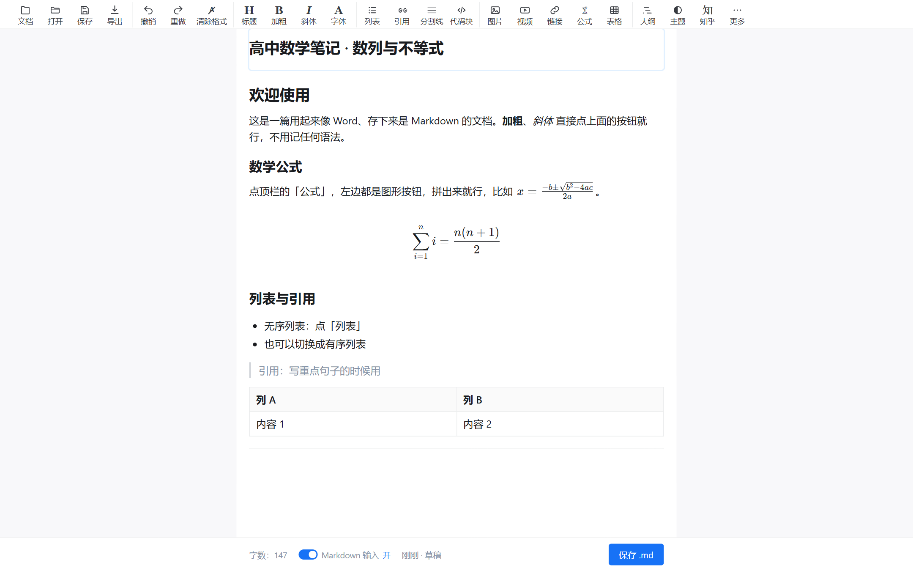
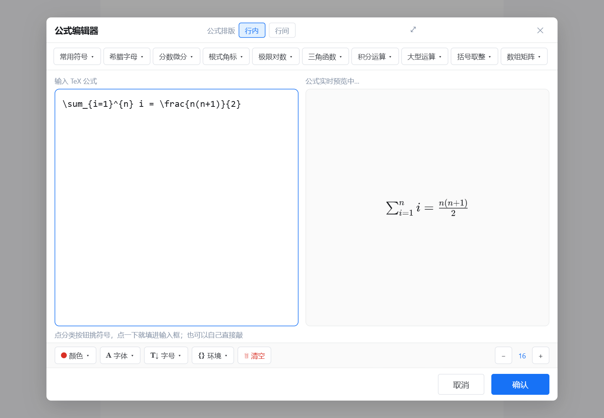
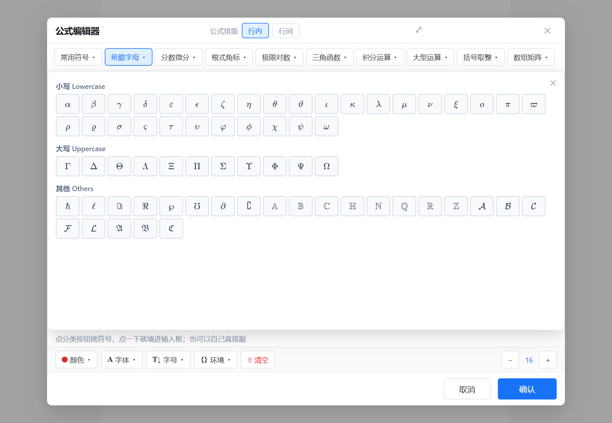
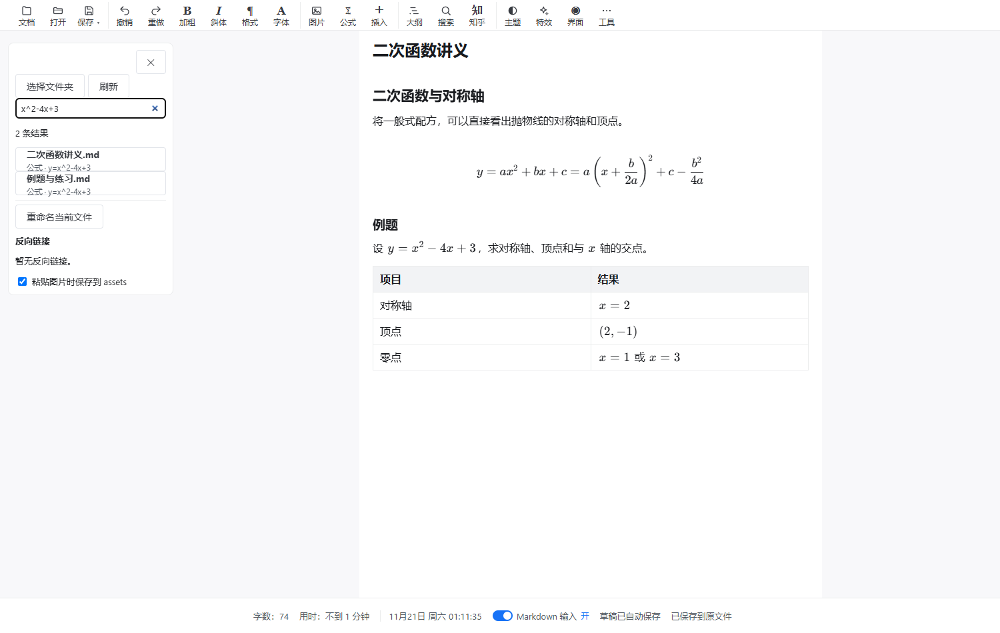
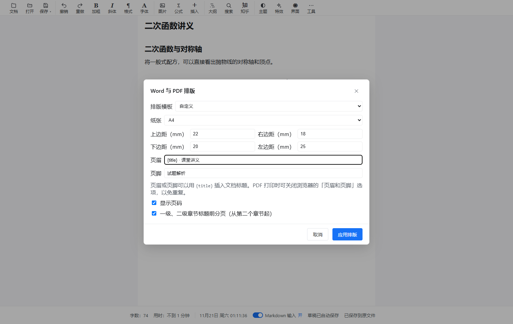
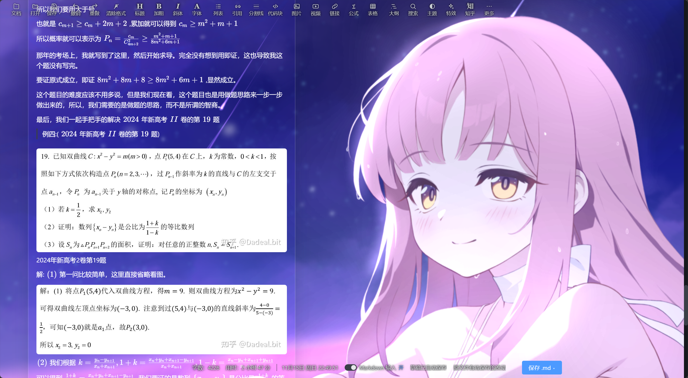
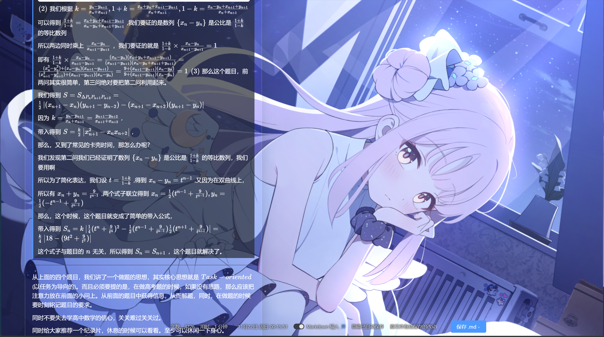

# Dadealbit Markdown 编辑器

**一个本地 Markdown 编辑器，适合写数学笔记、题解和讲义。** 下载一个 HTML 文件，用浏览器双击打开就能写：所见即所得，公式靠点按钮拼，也可以直接敲 LaTeX，存下来是标准 `.md`。不用安装、不用服务器、不联网，文档始终在自己电脑上。

> 写的时候像 Word，存下来像 Markdown。



---

## 这是什么

市面上写公式的编辑器大致两种：要么得先学 LaTeX / Markdown 语法，要么是网页服务（要联网、要登录、笔记不在自己手里）。这个项目的目标很具体：

**点按钮就能写出干净的数学笔记，文件永远在自己电脑上。**

- 打开一个 HTML 文件就能写，不需要安装、不需要服务器、不需要网络
- 公式用分类符号面板拼，也可以敲 LaTeX（带自动补全和实时预览）
- 存的是标准 `.md`：纯文本，任何编辑器都能打开，也不会被某个软件锁死
- 文档自动保存在本机浏览器里，关掉再打开还在
- 需要发知乎时，可以导出知乎能读的 `.md`，或由本机助手直接写进草稿箱

这个仓库构建的是**完整版**：在编辑器本体之外，还包含动态壁纸、鼠标特效、本地工作区、学术写作和 Word / PDF 出版。日常对外分发的精简版由同一份源码的另一条构建命令产出（见[快速开始](#快速开始)）。

## 功能

### 公式

- 公式弹窗里有 **10 个分类**：常用符号 / 希腊字母 / 分数微分 / 根式角标 / 极限对数 / 三角函数 / 积分运算 / 大型运算 / 括号取整 / 数组矩阵
- 共收录 **386 个符号**，每个都带中文名和 TeX 命令，点一下就填进输入框；也可以按中文名或命令搜索，打开时先显示最近用过的
- 支持直接敲 TeX：`\sum_{i=1}^{n}` 这类，边敲边补全（**最多 3 条候选**，带图形＋命令名＋中文名，↑↓ 选择、回车插入）
- 右侧**实时预览**；括号不配对、分母为空这类小错只给温和提示，不报错也不崩溃
- 能修的公式会先显示修复后的预览，确认时写入修复结果；支持剥离复制进来的外层定界符、转换常见的多行 TeX 环境
- 正文里的公式是一个积木块，点一下就能重新编辑
- 公式可以选**行内**（跟文字排在同一行）或**行间**（独占一行）；已经写好的公式点开再切一下也会真的换排版，不用删掉重插
- 长公式不会撑出正文：先自动缩放，仍放不下就在框内滚动
- 支持**公式自动编号与交叉引用**、**文档级 LaTeX 宏**；公式出问题时可导出诊断包（含每个公式的写法与操作历史）



### 排版与外观

- 标题（最多 6 级）/ 加粗 / 斜体 / 列表 / 引用 / 分割线 / 代码块 / 表格 / 链接 / 图片 / 视频，都是点按钮
- **插入视频**：粘贴 B 站（BV/av 号、播放器地址、手机分享文案都认）或 YouTube（`watch`、`youtu.be`、Shorts、直播回放都认）链接，正文里嵌成播放器，并附一个「在网页打开视频」；手机 App 分享的 `b23.tv` 短链会提示你去复制带 BV 号的完整链接
- **代码块能选语言**：**30 多种主流语言按字母顺序**排好（Python / JavaScript / C++ / SQL…），选哪种就按哪种上色；也可以选「自动识别」或「Plain text」。别人的 `.md` 里写 `js` / `py` / `yml` 这种简写也认，选了之后导出、存草稿都带着语言标记；这个版本还额外有「LaTeX 宏定义」「Mermaid」「BibTeX 文献库」三种特殊块
- 正文**字号、字体、文字颜色**可调（颜色作用于选中的文字）；颜色太暗时深色主题下会自动提亮显示，但不改文档内容
- **可以自己装字体**：选一个 `.ttf` / `.otf` 文件，装好即用、可删除；导出网页时会一起内嵌
- **纸张背景色**：7 个浅色预设 + 取色器，字色按对比度自动搭配；只改那张"纸"，工具栏和菜单仍跟主题走
- **浅色 / 深色主题**，也可以跟随系统；打印和导出 PDF 时强制回浅色
- 图片支持**左 / 居中 / 居右对齐**、图下说明、GIF 保真；表格可加题注
- 界面按知乎写文章页实测的配色与尺寸复刻，读起来是熟悉的感觉



### 文档、搜索与工作区

- **多篇文档**：在顶部标签页新建、切换和关闭草稿。需要管理文档库时，打开左侧「文档」。
- **搜索定位**：`Ctrl+F` 或工具栏「搜索」——输入就出结果（`第几条/共几条`），命中处黄底高亮、当前那条深底，下面列出每一处命中的原文（带前后文、关键词高亮），点哪条跳哪条；回车 / Shift+回车在命中之间跳，Esc 关掉。用的是编辑器自己的文档模型，所以**公式、代码块里的字也能搜到**；高亮只是显示层，不会改文档、也不会写进导出文件
- **替换文字**：在搜索框展开「替换文字」，可替换当前命中或全部文字命中，整次操作可撤销；公式命中可以定位到原处编辑
- **用了多久 / 现在几点**：左下角状态栏有「用时：X 分钟」（关掉再开接着累计），旁边是一枚每秒走的时钟
- **本地工作区**（「工具 → 本地工作区」）：打开一个目录，浏览其中的 Markdown；按**文件名、标题、正文或公式**搜索，点结果打开并定位；可看反向链接、预览重命名改动，并把编辑写回原文件
- 打开包含 Markdown 和 `assets` 的文档文件夹时，会自动读取正文引用的本地图片（保留 GIF 动画）
- **编辑 Markdown 源码**：想校对原始文本时切过去看/改，回来仍是排版视图
- **版本记录与对比**：保存过的版本可查看差异并恢复；**文档库备份**可以把整个浏览器文档库导出/导入
- **素材管理与断链修复**：列出当前文档的图片和视频引用，选素材的新目录、确认修复预览；同名冲突会单独提示，应用后可撤销，已连接项目里的相对路径随 Markdown 保存
- **检查与诊断**：「检查图片与公式」会体检当前文档（图片打不开 / 公式渲染不出来），能自动修的公式顺手修好



### 写作与学术

- **大纲与章节**：侧边大纲支持折叠 / 展开章节、上移 / 下移、拖拽重排；另有一份可打印的目录
- **阅读模式**：隐藏上下栏、锁定正文，进入只读沉浸状态（`Ctrl+Alt+R`）
- **专注模式**：只突出光标所在的这一段，其余淡出（只是显示效果，不改文档）
- **公式编号与交叉引用**：行间公式可自动编号，正文里插入引用；公式重新排序后引用自动更新，失效引用会被列出来
- **图表题注与引用**：图片和表格分别编号，可写题注、在正文引用；调整图表顺序后引用自动更新，失效引用可在「导出前检查」里定位
- **数学结构块**：定理 / 引理 / 定义 / 例题 / 证明，按章自动编号
- **脚注**：插入脚注引用，定义统一收在文末，编号自动维护
- **参考文献**：导入 BibTeX 文件，按引用键插入 `[1]` 这类引用，文末自动生成文献表
- **Mermaid 图表**：在代码块里选 Mermaid，流程图 / 时序图等实时渲染，导出时保留
- **Wiki 链接**：`[[另一篇文档]]` 形式互链，配合本地工作区形成笔记网络

### 出版与导出

「保存」一个按钮，点开选格式；有本地文件时最上面会多出「保存到原文件 / 另存副本」。

| 格式 | 说明 |
|---|---|
| 导出知乎用 Markdown（`.md`） | 公式换成知乎认的写法，本机图片自动上传换成公开网址 |
| 导出网页（`.html`） | 单文件离线网页，图片、字体、样式全在里面 |
| 另存为 PDF | 走浏览器打印对话框，选「另存为 PDF」 |
| 导出 Word（`.docx`） | 可在 Word 里继续编辑的文档 |
| Word 与 PDF 排版 | 选讲义 / 试题解析 / 自定义模板，设置纸张、边距、页眉页脚、页码、分章分页 |
| 一稿多版 | 标记提示 / 答案 / 解析后，预览并导出**学生版 / 教师版 / 知乎版** |
| 导出 Markdown 与图片（`.zip`） | Markdown 与本地图片打包，保留动图 |
| 导出 Markdown 存档（`.md`） | 图片内嵌的纯 Markdown，自己看 / 备份用（**不要**拿去知乎导入） |

- Word 和 PDF 共用一套排版设置：A4 / Letter、四边距（mm）、页眉页脚（支持 `{title}` 占位符）、是否显示页码、一二级标题是否分页（从第二个章节起）；默认、讲义、试题解析三套模板，也可以自定义
- **导出前检查**：按目标（Word / PDF / 知乎 / 知乎草稿）预检——没嵌入的图片与断图、渲染失败的公式、空公式、失效的公式 / 图表 / 脚注 / 文献引用、重复标签、BibTeX 与 LaTeX 宏解析、Mermaid 渲染，以及视频和动图的兼容性提示；先修再导
- 拿不到图床公开网址时**文件照样给**，只是那几张图上面会多一行提示，说清"这几张要手动补"



### 知乎

- **导入知乎正文**：从「打开」旁的菜单选择「从知乎链接导入」，再输入专栏文章或单篇回答地址。需要连接支持编辑器导入的桌面提取器或浏览器扩展。
- **粘贴知乎内容**：保留富文本里的行内公式和换行。复制带有知乎封面标记的动图时，编辑器会恢复原始 GIF 地址。

两条路，按需要选：

1. **导出 `.md`，用知乎自带的「导入」**——要的是一份能带走、能给别的平台用的文件时走这条。知乎导入**不认 `$…$` 公式**，所以导出时会把每个公式换成知乎自己的公式标记（``），导入后是可再编辑的真公式，标题层级、加粗、列表、引用、代码块、表格都照常带过去。
2. **让本机助手直接存进草稿箱**——省事、不用图床、不用手动导入。助手在本机 `127.0.0.1:5174` 起一个服务，用 Edge 驱动知乎写文章页，把正文 / 公式 / 图片 / 表格写进**草稿箱**。代码里没有任何「发布」路径，发布始终由你自己在知乎点。

助手要点：

- **只存草稿，不会发布**；同一篇文档反复上传会**更新同名草稿**，不会越堆越多（面板会写明「已更新」还是「新建」）
- 面板里的「检查一下能不能用（自检）」会另开一篇临时草稿，把正文 / 公式 / 图片 / 表格各真跑一遍，十几秒给结论——知乎改版导致"看着存进去了、刷新后是空的"时，靠它当场发现
- 有图片时会弹出一个浏览器窗口，并在推送期间占用剪贴板（每张图写一次，推完归还）；这是绕开知乎"图片导入会静默吞图"的没办法的办法，位置由正文标记保证，图不会跑到文末
- 只监听本机、需要令牌；登录态存在 `~/.dadealbit/`，不碰你日常用的浏览器
- 属于**非官方能力**（驱动网页操作，不是官方 API），知乎改版后可能需要更新助手
- 可选图床：在「知乎」面板里填一次 GitHub 令牌，导出 `.md` 时本机图片就会自动换成公开网址

### 动态壁纸

「特效 → 背景」里开启。正文变成一张浮在壁纸上的面板，壁纸可以是静态图、视频、Live2D、Spine，或者 Wallpaper Engine 项目。

**背景来源**

| 来源 | 说明 |
|---|---|
| 内置壁纸 | `CH0294 海边壁纸`，Spine 骨骼、图集、贴图随包 |
| 图片 / 视频 | png / jpg / webp / gif / avif / bmp；mp4 / webm / mov / m4v / ogv，视频可配 `wallpaper-time.json` 做分时播放 |
| Wallpaper Engine 项目 | 选含 `project.json` 的壁纸目录：`scene.pkg` 可在浏览器内离线渲染，也支持网页项目、视频、多分辨率 Spine；渲染不了时可退回项目预览图 |
| Spine 4.2 | 自选 `.skel` + `.atlas` + 全部贴图；同一项目有多个分辨率时给按钮切换 |
| 共享窗口 | 先在 Wallpaper Engine 里播放，再共享那个窗口或屏幕（网页版） |
| 使用记录 | 用过的背景自动入档，随时点回来 |

**播放与互动**：播放 / 暂停动画；「编辑时暂停」在正文或标题获得焦点时停住，离开后恢复；带流星素材的场景可开关流星；兼容的 Spine 角色支持**摸头**（点击或拖动头部区域）和**视线追踪**（指针移动带动眼神）；Wallpaper Engine 项目自带的时段、颜色等选项会挂进面板。

**材质与构图**：正文面板可选**毛玻璃 / 磨砂 / 实色**，调面板不透明度（0–100%）与背景模糊（0–32 px）；正文框可左右移动、调距顶部距离，背景可选填满窗口或完整显示；Spine 另有缩放和左右 / 上下位置。每套壁纸单独保存自己的构图，随时「恢复默认构图」。

**使用记录与场景预设**：每条记录可写备注（1000 字）、搜索、删除（删除会清掉该条记录及浏览器缓存，本机原文件不受影响）；「写作场景预设」把当前壁纸 + 材质 + 不透明度 + 构图存成一个具名场景，可手动应用，也可**绑定到某篇文档**——打开那篇文档就自动套用。

**Windows 原生模式**：双击 `启动器\Wallpaper Engine 原生模式.bat`，在「特效 → 背景」里选「选择 Wallpaper Engine 原生壁纸」，编辑器会让 Wallpaper Engine 在专用窗口里播放，再用窗口捕获把实时画面当背景（比共享窗口更稳，也不占你的桌面）。桌面模式使用独立的文档库和设置，可通过 Markdown 文件导入已有文档；关闭原生背景会释放专用播放窗口。





> 兼容性说明：不同 Wallpaper Engine 场景的着色器、资源和脚本支持程度有差异，不保证与原生播放完全一致；系统音频感应未接入。Live2D 需要本地资源完整、使用普通脚本入口的网页项目，依赖外部网站或 ES 模块的项目可改用预览图或窗口共享。Spine 运行库遵循其单独许可（见[许可](#许可)），壁纸与游戏素材由使用者自行提供。

### 鼠标与指针

「特效 → 鼠标」里调，全部设置存在本机、刷新后保持。

- **档位**：关闭 / 只显点击波纹（默认）/ 点击 + 拖尾
- **缩放比例** 0.5–3×、**全局不透明度** 10–100%
- **速度**：拖尾与点击可以共用一个动画速度，也可以分开调「拖尾衰减」「点击爆发」；另有**拖尾刷新率** 10–240 Hz，调低更省性能
- **颜色**：6 个预设色 + 取色器；选过的颜色留在「我的颜色」（最多 8 个，左键使用、右键删除）；可开**彩虹**让色相沿轨迹流动，也可加**第二个颜色**做渐变
- **自定义鼠标指针**：整页换成自带的箭头指针（按钮仍是手型），可整体右移 / 下移；面板里有一块**校准区**，在那儿点一下会落一个红叉（浏览器认定的点击位置），照着把箭头尖端对上去
- **点击特效位置**：圆画在哪儿可以单独微调（±40 px），**指针本身一点不动**——"指针怎么放"和"圆画在哪"是两件互不影响的事
- 每个滑块的数字都能点进去直接输精确值，按回车应用；「恢复默认设置」一键复原
- 特效画在一层 `pointer-events:none` 的透明画布上，**永远不挡鼠标操作**；打印 / 导出 PDF 时自动隐藏，关闭时连动画循环都停

### 界面与操作

- **顶部快捷操作**：宽屏下直接显示撤销、重做、标题、加粗、表格、大纲和阅读模式等入口。窄窗口可从「编辑」「插入」「界面」菜单访问这些功能。

- **顶部工具栏**或**透明悬浮球**二选一（「界面」里切换）。悬浮球可拖动、记住位置，空闲 3 秒自动隐藏，按 `Ctrl+Alt+T` 唤出；「重置悬浮球位置」回到左上角
- 浅色 / 深色 / 跟随系统三档主题
- **32 个动作可自定义快捷键**，帮助面板里的键位会跟着变
- 全屏、专注模式、阅读模式各自独立
- **使用反馈**：「工具 → 使用反馈（发邮件给作者）」里已经把当前文档字数 / 本次用时 / 累计用时填好了，点一下用邮件发出（也可以复制）。只带这几个数字，**不会带上你的文档内容**
- 工具栏「工具」菜单还是个可搜索的功能面板：忘了按钮在哪，直接搜功能名

## 快速开始

### 直接使用（推荐给只想写字的人）

1. 打开 [最新 Release](https://github.com/Dadeal167/Dadeal.bit-Markdown-Editor/releases/latest)，下载单文件 HTML
2. 双击打开（Edge / Chrome 都行）——不需要装 Node、不需要联网
3. 想存知乎草稿箱时，再下同一个 Release 里的 Windows 知乎助手包，解压后双击 `启动器\开始使用.bat`

没看错，就一个文件（精简版约 2.8 MB），JS / CSS / 数学字体全部内联在里面。可以拷到 U 盘、发给同学，对方双击就能用。

> 从旧版升级前，先用**原来的浏览器和 HTML** 打开编辑器，把文档导出为 Markdown。浏览器按文件路径隔离本地存储，换文件名、目录或浏览器后可以重新导入。

### 从源码构建（完整版 / 改代码）

需要 Node.js 22.12 或以上版本和 pnpm。

```bash
pnpm install --frozen-lockfile

pnpm build         # 完整版 → Dadealbit Markdown 编辑器-特效版.html（约 16 MB）
pnpm build:pure    # 精简版 → Dadealbit Markdown 编辑器.html（约 2.8 MB，对外发布的那份）
pnpm build:both    # 两个都出
```

构建完直接双击根目录生成的那个 HTML。`dist/index.html` 是同一份内容。

其他常用命令：

```bash
pnpm dev           # 开发服务器 http://127.0.0.1:5173（改代码即时生效）
pnpm build:web     # 常规多文件产物（给将来的 Electron/Tauri 外壳或服务器部署用）
pnpm pack:folders  # 打出交付文件夹
pnpm make:bundle   # 打知乎助手包（含便携 Node）
```

> 开发服务器是临时进程，窗口一关就打不开了；`file://` 打开的和 `http://127.0.0.1:5173` 打开的**笔记互相看不见**（浏览器按来源隔离存储），要搬内容就用「保存 .md」→ 另一边「打开」。

### Windows 桌面 / 原生壁纸

```text
启动器\
  开发模式.bat              # 起开发服务器
  重新构建.bat              # 重新打包
  启动知乎助手.bat          # 前台起助手（留窗口，方便看原因）
  Wallpaper Engine 原生模式.bat
```

原生模式首次运行会在 `desktop\` 下安装 Electron（需要 Node 22.12+，第一次要下载运行时）。之后双击该 `.bat` 即可用一个独立窗口打开完整版编辑器；在「特效 → 背景」里选择 Wallpaper Engine 原生壁纸时，编辑器会让 Wallpaper Engine 在专用窗口里播放并捕获画面。

## 快捷键

`Mod` 在 Windows 上是 `Ctrl`，在 Mac 上是 `Cmd`。

| 动作 | 默认键 | 动作 | 默认键 |
|---|---|---|---|
| 保存 | `Ctrl+S` | 打开 | `Ctrl+O` |
| 新建文档 | `Ctrl+Alt+N` | 我的文档 | `Ctrl+Alt+D` |
| 撤销 / 重做 | `Ctrl+Z` / `Ctrl+Shift+Z` | 加粗 / 斜体 | `Ctrl+B` / `Ctrl+I` |
| 清除格式 | `Ctrl+\` | 标题 1/2/3 | `Ctrl+Alt+1/2/3` |
| 正文 | `Ctrl+Alt+0` | 引用 | `Ctrl+Shift+9` |
| 无序 / 有序列表 | `Ctrl+Shift+8` / `Ctrl+Shift+7` | 代码块 | `Ctrl+Alt+C` |
| 插入公式 | `Ctrl+Shift+M` | 插入表格 | `Ctrl+Shift+T` |
| 插入链接 | `Ctrl+K` | 插入图片 | `Ctrl+Shift+P` |
| 存为 PDF | `Ctrl+P` | 全屏 | `Ctrl+Shift+F` |
| 大纲 | `Ctrl+Alt+O` | Markdown 输入开关 | `Ctrl+Shift+K` |
| 显示悬浮球 | `Ctrl+Alt+T` | 切换阅读模式 | `Ctrl+Alt+R` |
| 搜索功能 | `Ctrl+Alt+K` | 快捷键设置 | `Ctrl+/` |

搜索是 `Ctrl+F`，回车 / Shift+回车在命中之间跳，Esc 关掉。全部 32 个动作都能在「工具 → 自定义快捷键」里改键。

## 常见问题

**我的笔记存在哪？会不会丢？**
笔记和自装字体保存在这台电脑的浏览器里。笔记优先写入 IndexedDB（额度按磁盘剩余空间算，图片多也不会几篇就写满），较小的文档库还会留一份 localStorage 备份；主题、字号、快捷键、特效等设置存 localStorage。关掉浏览器、重启电脑都还在，但**清空浏览器数据会一起清掉**，重要的东西建议定期「保存 .md」留一份文件。

**为什么「双击打开」和「开发服务器」里的笔记互相看不见？**
浏览器按来源隔离数据：`file://` 打开的和 `http://127.0.0.1:5173` 打开的是两套存储。要搬内容就用「保存 .md」→ 另一边「打开」。

**提示"改动没能保存"？**
多半是浏览器被设成不保存数据 / 隐私模式 / 磁盘真的满了。先「保存 .md」把这篇导出到文件，再排查浏览器设置。

**导入的 `.md` 里图片是裂的？**
不少导出工具（知乎导出、"网页转 Markdown"工具等）把图片存成旁边的 `assets/xxx.jpg`，正文里写相对路径。编辑器是一个单独打开的本地网页，浏览器出于安全限制不允许它去读旁边的文件夹，所以这些图一定是裂的。导入后编辑器会浮出提示，点「选导出文件夹修复」选中那个装着 `assets` 的目录即可——图片会按文件名自动配对、压缩后嵌进文档（关掉再打开还在）。也可以随时用「工具 → 检查图片与公式」重新体检。

**公式变成红框 / 显示不出内容？**
大多不是编辑器的问题，而是源文件里的写法坏了：导出工具常把公式里的反斜杠多写一层或少写一层（`\left \\{ x \right \\}`、结尾多个 `\`、`\or` 这类不存在的命令）。导入时会自动修好能修的，修不了的那个公式会套一个红框并提示"写法有问题，点击修改"，点一下就能手动改；旧文档可以点提示条上的「一键修复公式」批量修。

**从网页复制粘贴过来的公式为什么是乱的？**
很多导出工具生成的 HTML 里，公式**本来就是纯文本 `$…$`**。现在三条路都处理了：粘贴 Markdown 文本时先保护公式；从网页粘贴后自动把正文里的 `$…$` 转成真公式；已经粘坏了的旧文档，提示条上会出现「转成公式」批量转好。只有内容看着确实像公式的才会转，所以"原价 $100，现价 $60"这种正文不会被误伤。

**表格能传到知乎吗？**
「导出知乎用 .md」会保留表格。用知乎助手存草稿时，助手会分段写入正文和表格，并报告表格数量是否对得上。表格单元格里的公式建议在知乎草稿里复核。

**深色主题打印出来是黑底吗？**
不会，打印 / 导出 PDF 时会强制回到浅色。

**我的 Mac / 手机能用吗？**
HTML 本身在 Mac、Linux 和手机浏览器都能打开，但只针对 Windows + Edge 做过完整验证；桌面模式和知乎助手目前只有 Windows 版本。

## 技术栈

- [TipTap 3](https://tiptap.dev)（ProseMirror）+ React 19 + TypeScript
- [KaTeX](https://katex.org) 渲染公式；`markdown-it` 负责 Markdown 解析
- 大量自研 TipTap 扩展：公式节点、图片节点、表格序列化、公式编号、题注引用、章节、脚注、数学结构块、Wiki 链接、分版块
- [Mermaid](https://mermaid.js.org) 画图、[citation-js](https://citation.js.org) 解析 BibTeX、[docx](https://docx.js.org) 生成 Word、[fflate](https://github.com/101arrowz/fflate) 打 zip
- 动态壁纸：[webwallgl](https://www.npmjs.com/package/webwallgl)（Wallpaper Engine 场景）、[Spine WebGL](https://esotericsoftware.com/spine-runtimes) 4.2
- 知乎助手：Node HTTP 服务 + [playwright-core](https://playwright.dev) 驱动本机 Edge
- Vite 打包；交付时把所有资源内联成**单个 HTML**（`file://` 下浏览器会拦截外部 module 脚本和样式表，所以必须内联）

## 开发

```bash
pnpm check:all        # 一把跑完：构建 + 起 dev server + 全部套件 + 汇总表
pnpm check:all --no-build --only=check:paste   # 只跑指定的那一套
```

这个项目比较看重的两点：

1. **改动都要有验证**——仓库里有几十套自动化验证、上千条断言，从核心交互、逐按钮点击、386 个符号逐个渲染，到"关掉浏览器再打开数据还在"、动态壁纸渲染与鼠标特效的像素采样。
2. **单一交付物**——所有功能最终都收进那一个 HTML 文件里，不引入运行时依赖，也不要求用户装任何东西。

常用套件（完整清单见 `package.json` 的 scripts）：

| 命令 | 覆盖 |
|---|---|
| `pnpm probe` | 核心交互与尺寸 |
| `pnpm audit:buttons` / `audit:features` / `audit:docs` | 逐按钮 / 真人会踩的边角 / 多文档 |
| `pnpm audit:effect` | 鼠标特效（真采样画布像素、换色、关闭后不绘制、打印隐藏、尖端与点击点对齐） |
| `pnpm audit:theme` / `audit:typography` / `audit:shortcuts` / `audit:persistence` | 主题 / 排版 / 快捷键 / 持久化 |
| `pnpm check:effects` | 分版与阅读模式、工具栏与悬浮球、本地工作区与出版、壁纸历史与写作预设 |
| `pnpm check:wallpaper-scene` / `check:wallpaper-web` / `check:wallpaper-library` | 场景壁纸渲染、Live2D 网页壁纸、Wallpaper Engine 项目兼容性 |
| `pnpm check:zhihu-export` / `check:zhihu-images` / `check:assistant-inject` | 知乎导出与助手写入手法 |
| `pnpm check:indexeddb` / `check:offline` / `check:no-secrets` | 存储 / 双击可用性 / 没夹带令牌 |
| `pnpm check:parity-source` / `check:parity-builds` | 两条构建产物的差异守卫 |
| `pnpm mutation:parity` / `mutation:latex-repair` / `mutation:math-markdown` | 变异测试（证明守卫真的会翻红） |

壁纸兼容性可用 `pnpm check:wallpaper-library "<创意工坊 431960 目录>"` 批量看；Windows 原生播放用 `node scripts/check-native-wallpaper.mjs "<项目目录下的 project.json>"`。

## 目录结构

```
src/
  App.tsx / main.tsx      入口
  editor/
    ZhihuEditor.tsx       主界面编排（文档、快捷键、排版、主题、背景、弹窗、提示条）
    useMarkdownEditor.ts  TipTap 实例与扩展配置
    editorActions.ts      排版命令、表格、插入、导入导出、图片内嵌修复
    toolbar/              工具栏功能目录、分组与搜索
    workspace/            本地工作区、文档备份、源码编辑与版本对比
    publication/          保存格式、Word/PDF 导出、分版与出版排版
    math/                 386 个符号、公式修复、公式索引、文档宏
    tiptap/               Markdown ⇄ 公式、图片、表格、章节、题注、脚注等扩展
    effects/
      background/         背景来源、播放、材质、构图、使用记录与场景预设
        media/            图片、视频、窗口画面
        spine/            Spine 素材、动画与人物互动
        wallpaper/        Wallpaper Engine 项目、场景与分时播放
      pointer/            指针与点击效果设置
      mouseSpark.ts       鼠标特效算法（第三方，原样搬运）
    MathModal.tsx         公式编辑器（分类符号面板 + TeX 输入 + 实时预览）
desktop/                  Windows 桌面窗口与 Wallpaper Engine 命令接口
scripts/                  构建、打包、自动化验证、知乎助手
  zhihu-assistant.mjs     本机助手（存草稿箱 / 传图床）
  make-packages.mjs       打交付文件夹
  make-launcher.mjs       生成启动器与便携 Node
docs/                     截图、开发文档
  screenshots/            README 用图
examples/                 示例配置（壁纸分时）
```

## 已知限制

- **知乎草稿箱是非官方能力**（驱动网页操作），知乎改版后可能需要更新助手；表格单元格里的公式目前还进不去，建议导入后在知乎草稿里复核
- **视频在知乎只保留原始链接**（两个入口都一样）
- 文档存在浏览器的 IndexedDB 里，额度按磁盘剩余空间算；老数据会自动从 localStorage 迁过来，迁移后那份继续当冷备份。真正写不进去的情况只有隐私模式 / 浏览器被设成不保存数据 / 磁盘满
- 导出 `.md` 这条路依赖图床：图片要能变成**公开网址**知乎才抓得到；极小的图（几百字节）知乎的抓图服务会判「上传失败」。用「存到草稿箱」则没有这两个问题
- **公式跨行、`$` 配对异常的文件不会自动跨行配对**：导入时用占位符先保护 `$…$`，配不成对的 `$` 会留在正文里（看得见），不会静默吞掉后面的内容。自动跨行配对存在误配正文 `$` 的风险（例如把「原价 $100，现价 $60」吞成一个公式），故不实现
- **动态壁纸**：Wallpaper Engine 场景的兼容性取决于具体壁纸（着色器、脚本、资源），不保证与原生一致；系统音频感应未接入；Live2D 只支持本地资源完整、普通脚本入口的项目
- **桌面 / 原生壁纸模式**仅 Windows，首次运行需要 Node.js 22.12+ 下载 Electron 运行时
- 界面只针对 Windows + Edge 做过完整验证，Mac / Linux / 手机浏览器能打开但没有针对性适配

## 许可

本项目使用 [`LICENSE`](LICENSE) 中所列的 **Dadealbit 使用许可**（中英对照）：

- 免费使用、复制、修改、合并、发布、分发、再许可，个人 / 学习 / 商业用途都可以
- 必须保留许可声明与版权声明
- **不得用于任何违法活动**，也不得用它帮助他人实施违法活动
- 按「现状」提供，不附带任何担保

第三方组件遵循各自的许可：WebWallGL、Mediabunny 的许可文本随单文件产物内嵌；Spine 运行库遵循 [Spine Runtimes License](https://esotericsoftware.com/spine-runtimes-license)；界面中的自定义鼠标指针使用《蔚蓝档案》的游戏素材。 [BA-Pointer](https://github.com/Dr-hydra/BA-Pointer)
